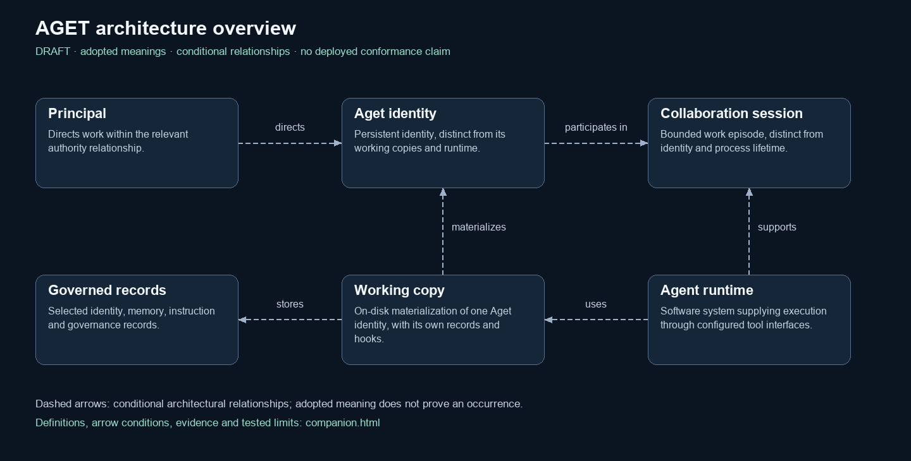
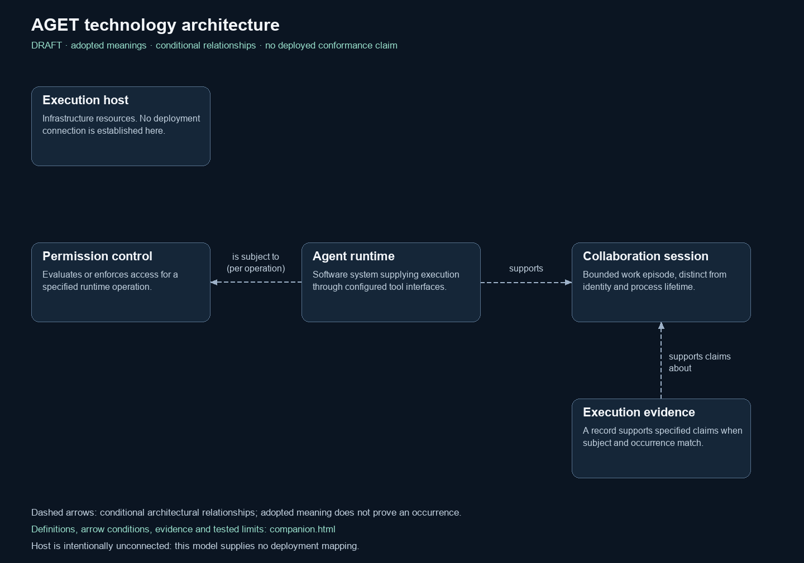

# Grounded AGET architecture views

The overview and technology diagrams share adopted concepts and directed relationships. They separate a persistent [Aget identity](accepted-draft/public-model.json#L64-L67) from its [working copy](accepted-draft/public-model.json#L114-L117), [runtime](accepted-draft/public-model.json#L292-L295) and [collaboration session](accepted-draft/public-model.json#L242-L245). These views explain architectural meanings; they do not certify an installation or a particular permission decision.

This guide is for readers learning the framework, builders interpreting its relationships, and maintainers reviewing its claims. Its scope is the two views and their selected model, not all framework behavior. The inline definition links open the readable exact model; the portable companion supplies the visual guide and parent meanings.

## Publication context

| Field | Disposition |
|---|---|
| Publication edition | Landing-page correction dated October 12, 2026. The diagrams, companion and model remain the accepted draft edition of October 8, 2026; their original bytes and review-time labels are retained. |
| Framework source basis | The model's framework citations use [source revision 06a9f453d0d676ea068a23ee2167a4a17f29dc78](https://github.com/aget-framework/aget/tree/06a9f453d0d676ea068a23ee2167a4a17f29dc78). This is the framework source basis, not the publication's commit. |
| Intended and assessed applicability | Intended for interpreting the selected model and cited framework passages. Applicability to a numbered product release is **not established**; no runtime compatibility test is claimed. The framework maintainer owns assessment before the next substantive revision or any release-applicability claim, whichever occurs first. |
| Release membership | **Not established** for a numbered release. Publication between releases and a source revision do not prove inclusion in a release. The framework maintainer will check tagged contents before a membership claim or the next substantive revision. |
| Evidence strength | The model reports scoped definition, relationship and constraint checks. Its evidence summary is a report of the October 8 review, not a rerun or a runtime certificate. Whole-register and citation-access limits are stated below. |

## Overview

[Vector overview](accepted-draft/overview.svg)

## Technology

[Vector technology view](accepted-draft/technology.svg)

## Definitions and arrows

[Download the complete guide and diagrams](https://raw.githubusercontent.com/aget-framework/aget/main/docs/architecture/grounded-views-2026-10-08/grounded-architecture.zip) ([repository file](grounded-architecture.zip)), extract the archive, and open `companion.html` for the definitions, parent meanings, arrow directions and conditions, source support, constraints and tested limits. Open `index.html` to view both diagrams together. No account, private ontology or private evidence record is needed to read the downloaded package.

[Exact public model](accepted-draft/public-model.json) preserves the adopted definition fields. [Companion HTML source](accepted-draft/companion.html) is available separately. GitHub shows the HTML source; the portable guide is viewed after download, not as a hosted website.

## Edition and tested limits

The underlying package is the accepted draft edition of October 8, 2026. The enclosed files preserve their review-time draft labels and original bytes. The publisher attests that the Principal approved the selected architectural meanings on October 8, 2026; this acceptance does not adopt every framework claim or certify runtime enforcement. Adoption of the selected model does not establish whole-ontology correctness: the model’s `evidence_summary.full_register_findings` reports 1,510 blocking findings and 1,136 warnings for the wider source register at that review. The raw register and its audit are not part of this public package, so those historical figures cannot be independently recomputed from the download. Scoped model and constraint checks do not certify production runtime enforcement.

The guide embeds the concepts and parent definitions themselves. Its public framework passages are pinned to the cited revision. The external definition-sentence method citation returned a rate-limit error during the October 8 access check; eighteen other external citations were reported as passing that check. These are dated access reports, not present access guarantees; the raw probe log is not included. Retain that distinction when using the references.

The enclosing repository's license applies to this original architecture package; linked external sources retain their respective terms. Definitions, conditions and evidence limits are contained in the companion and exact model.

## Maintenance and unresolved evidence

The framework Aget is the accountable maintainer of this publication. Report unclear meanings, broken links or contradictory claims through the [public issue tracker](https://github.com/aget-framework/aget/issues). Review is triggered by a substantive publication change, a changed supporting source or definition, a reported discrepancy, or a release that affects an applicability claim; it need not wait for a release.

The exact model supplies each directed relationship's conditions and public support, and each constraint's predicate and positive/negative cases. Those cases explain the check; they are not evidence that a deployed runtime enforces it. The maintainer owns unresolved numbered-release applicability, membership and public reproducibility of the historical audit/access reports, to be reviewed before the next substantive revision or reuse of those claims. Historical report disclosure does not establish the underlying facts independently.
